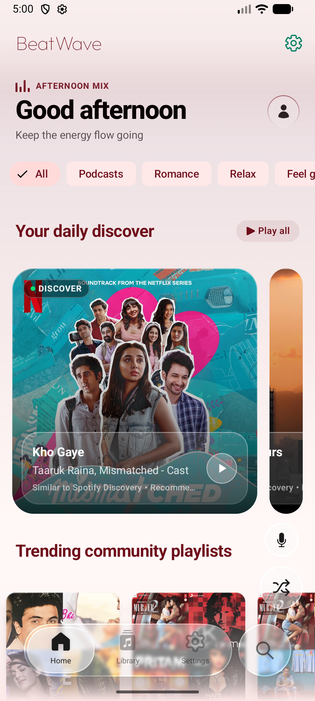
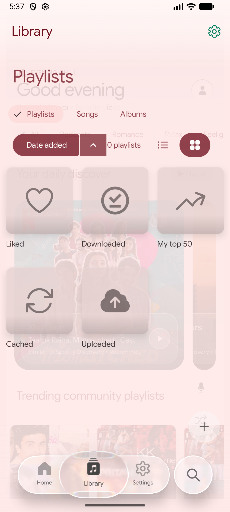
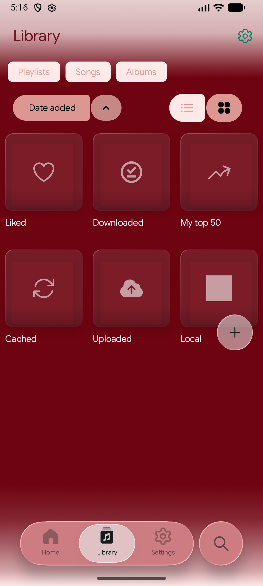
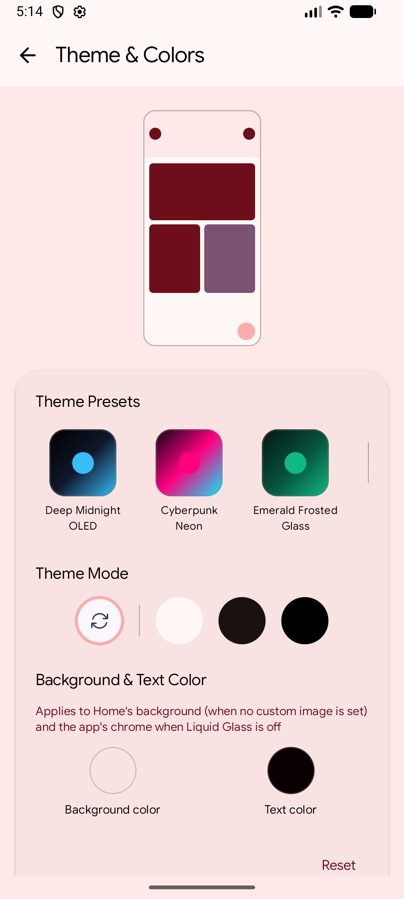

# 🌊 BeatWave Liquid Glass UI Architecture & Studio

> **Reverse-engineered from [BeatWave](https://github.com/vortexapps67/BeatWave) (vortexapps67/BeatWave)**  
> Production-grade Android Jetpack Compose + AGSL (Android Graphics Shading Language) Liquid Glass UI system with an interactive live optical studio.

---

## 📱 Live Production APK & Studio Screenshots

<p align="center">
  
  
  
  
</p>

---

## 📌 Overview

BeatWave's signature visual identity relies on a custom **Physical Liquid Glass Engine** built directly on top of Android 13+ (API 33+) `RuntimeShader` and Jetpack Compose 1.7+ `GraphicsLayer`. 

Unlike standard web or mobile "glassmorphism" that only applies flat Gaussian blur (`RenderEffect.createBlurEffect`), BeatWave performs **real-time ray refraction, continuous squircle SDF evaluation, 7-band spectral chromatic dispersion, and drifting specular edge glints**.

---

## 🔬 Reverse-Engineered Architecture & Core Math

```
┌─────────────────────────────────────────────────────────────┐
│                    App Background Content                   │
│   (Album Artwork, Animated Meshes, Dynamic Visualizer)      │
└──────────────────────────────┬──────────────────────────────┘
                               │
            Captured via GraphicsLayer.record()
            Downscaled to 0.30x Glass Resolution Scale
                               │
                               ▼
┌─────────────────────────────────────────────────────────────┐
│                 AGSL RuntimeShader Pipeline                 │
│                                                             │
│  1. 2D SDF: sdRoundedRect(coord, halfSize, radii)           │
│  2. Surface Normal: gradSdRoundedRect(coord)                │
│  3. Lens Refraction: d = circleMap(d / refractionHeight)    │
│  4. 7-Band Spectral Dispersion:                             │
│     Red (700nm) ... Green (546nm) ... Violet (400nm)        │
│  5. Dynamic Specular Rim:                                   │
│     lightVector = rotate(vec2(1,1), angle(t))              │
│     specular = pow(dot(normal, lightVector), 8.0)           │
└──────────────────────────────┬──────────────────────────────┘
                               │
                               ▼
┌─────────────────────────────────────────────────────────────┐
│          Composable UI (Floating Bar, Player Card)          │
└─────────────────────────────────────────────────────────────┘
```

### 1. 2D Signed Distance Field (SDF) of Rounded Rectangles
In AGSL, every pixel's distance to the perimeter of the rounded pill is computed mathematically:

```glsl
float sdRoundedRect(float2 coord, float2 halfSize, float radius) {
    float2 cornerCoord = abs(coord) - (halfSize - float2(radius));
    float outside = length(max(cornerCoord, 0.0)) - radius;
    float inside = min(max(cornerCoord.x, cornerCoord.y), 0.0);
    return outside + inside;
}
```

### 2. Optical Lens Refraction via Circle Mapping
Light passing near the curved edge of the glass curves inward according to a spherical surface map:

$$\text{circleMap}(x) = 1.0 - \sqrt{1.0 - x^2}$$

$$\text{refractionOffset} = \text{normal} \times \text{circleMap}(d / \text{lensHeight}) \times \text{lensAmount}$$

### 3. 7-Band Chromatic Aberration (Prism Dispersion)
Real glass bends violet and blue light more steeply than red light (Cauchy's dispersion equation). BeatWave simulates this by sampling the backdrop texture across 7 discrete wavelengths:

| Wavelength | Color | Dispersion Weight |
|---|---|---|
| 700 nm | Red | $+3 \times \Delta$ |
| 620 nm | Orange | $+2 \times \Delta$ |
| 580 nm | Yellow | $+1 \times \Delta$ |
| 546 nm | Green (Anchor) | $0 \times \Delta$ |
| 490 nm | Cyan | $-1 \times \Delta$ |
| 450 nm | Blue | $-2 \times \Delta$ |
| 400 nm | Violet | $-3 \times \Delta$ |

### 4. Dynamic Specular Rim Drift
Rather than drawing a static border stroke, an edge glint is calculated against a rotating virtual key light vector:

$$\theta(t) = 45^\circ + 25^\circ \times \sin\left(\frac{2\pi t}{7000\text{ ms}}\right)$$

This causes light reflections to drift organically across the glass pills as the user interacts with the app.

---

## 📁 Repository Structure

```
liquid-glass-ui/
├── README.md                           # Architecture breakdown & quickstart guide
├── android/                            # Production Jetpack Compose + AGSL implementation
│   ├── Shaders.kt                      # AGSL shader code (SDF, Refraction, Dispersion, Rim)
│   ├── BackdropCapture.kt              # Compose 1.7+ GraphicsLayer offscreen backdrop recording
│   └── LiquidGlass.kt                  # Modifier.liquidGlass() with 3-tier device fallback
└── showcase/                           # Live Interactive Web Studio (Zero Dependencies)
    ├── index.html                      # Interactive mobile mock, audio player, inspector
    ├── style.css                       # Modern dark glassmorphic stylesheet & animations
    └── app.js                          # Realtime controls, presets, audio scrubber, 3D tilt
```

---

## 🚀 Using in Android Jetpack Compose

### Step 1: Wrap your screen content with the backdrop recorder

```kotlin
import androidx.compose.foundation.layout.Box
import androidx.compose.foundation.layout.fillMaxSize
import androidx.compose.runtime.Composable
import androidx.compose.ui.Modifier
import com.liquidglass.ui.backdrop.layerBackdrop
import com.liquidglass.ui.backdrop.rememberLayerBackdrop

@Composable
fun MusicScreen() {
    val backdrop = rememberLayerBackdrop()

    Box(
        modifier = Modifier
            .fillMaxSize()
            .layerBackdrop(backdrop)
    ) {
        // Your scrollable list, album artwork, lyrics canvas, etc.
        AlbumArtworkBackground()

        // Floating Glass UI elements overlaying the backdrop
        NowPlayingPlayer(backdrop = backdrop)
        FloatingGlassNavBar(backdrop = backdrop)
    }
}
```

### Step 2: Apply `.liquidGlass()` to any composable

```kotlin
import androidx.compose.foundation.shape.RoundedCornerShape
import androidx.compose.ui.unit.dp
import com.liquidglass.ui.backdrop.GlassEffectConfig
import com.liquidglass.ui.backdrop.GlassRenderingMode
import com.liquidglass.ui.backdrop.liquidGlass

@Composable
fun NowPlayingPlayer(backdrop: LayerBackdrop) {
    Box(
        modifier = Modifier
            .fillMaxWidth()
            .padding(16.dp)
            .liquidGlass(
                backdrop = backdrop,
                config = GlassEffectConfig(
                    mode = GlassRenderingMode.LIQUID,
                    blurRadiusDp = 24f,
                    vibrancy = 1.2f,
                    tintOpacity = 0.45f,
                    lensHeight = 0.40f,
                    lensAmount = 0.60f,
                    chromaticAberration = true,
                    specularRimAlpha = 0.55f
                ),
                shape = RoundedCornerShape(32.dp)
            )
    ) {
        // Player controls, sliders, track titles
        PlayerContent()
    }
}
```

### 3-Tier Hardware Fallback Strategy

The library automatically inspects device hardware capabilities:

| Hardware Tier | Conditions | Shader Strategy | GPU Impact |
|---|---|---|---|
| **High Tier** | Android 13+ (API 33), $\ge 6\text{ GB}$ RAM | AGSL RuntimeShader + SDF Refraction + 7-Band Dispersion | High fidelity, 60-120 FPS |
| **Mid Tier** | Android 12 (API 31-32) or 4-6 GB RAM | `RenderEffect.createBlurEffect` + Surface Tint | Standard frosted blur |
| **Low Tier** | Android 11 and lower or Low-RAM Mode | Semi-transparent solid tint + 1px subtle border | Zero shader overhead |

---

## 🎨 Interactive Live Showcase Studio

An interactive studio is provided in the `showcase/` directory.

### Quick Start:

1. Open `showcase/index.html` directly in any modern web browser, or launch a quick local server:
   ```bash
   npx serve liquid-glass-ui/showcase
   ```
2. Features available in the studio:
   - **Live Optical Sliders**: Adjust Lens Height, Refraction Amount, Blur Radius, Vibrancy Boost, Tint Opacity, and Specular Rim Alpha.
   - **Spectral Dispersion Toggle**: Enable/disable 7-band RGB chromatic aberration.
   - **Dynamic Light Drift**: Real-time periodic oscillation of the light reflection vector.
   - **One-Click Presets**:
     - *BeatWave Liquid*: Signature saturated, refractive Android experience.
     - *Apple Music Frosted*: Soft, diffuse frosted glass aesthetic.
     - *Crystal Prism*: Hyper-refractive, high-rim spectral glass.
     - *Subtle Dark Pill*: Minimalist low-opacity dark mode.
   - **Functional Music Player**: Track scrubber, play/pause, playlist switching, synced lyrics preview, and active navigation puck physics.
   - **3D Tilt Interaction**: Move cursor over the smartphone frame to test specular highlights from dynamic angles.

---

## 📜 Credits & License

- Reverse engineered from [BeatWave](https://github.com/vortexapps67/BeatWave) by VortexApps.
- Designed for Android Jetpack Compose & modern design engineering.
